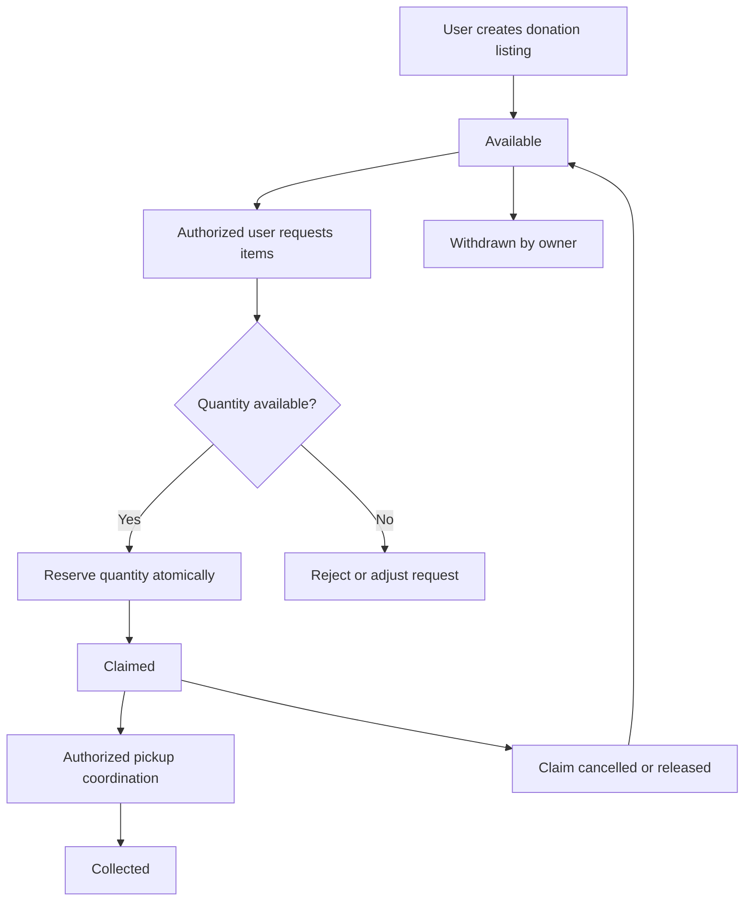
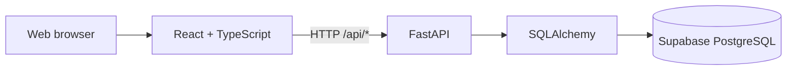

🤝 WarmShare
Share Warmth. Build Community.
A community-driven clothing donation and distribution platform

Connect people who have clothing to share with people and organizations who need it—through a transparent, accessible, and privacy-conscious donation workflow.

Live Application · Repository · API Health

About WarmShare
Usable clothing and essentials often remain unused while individuals and communities face shortages. WarmShare aims to make local giving easier to coordinate, reduce waste, and help donations reach people who can use them.

WarmShare is designed as a full clothing donation lifecycle platform, not merely a listing board. The product vision includes secure accounts, donation discovery, claiming and reservation, collection coordination, NGO campaigns, volunteer support, moderation, and transparent status tracking.

Current release: A deployed, working CRUD foundation for donation listings. The full platform capabilities described below are the target product specification; features not yet implemented are clearly marked in the roadmap.
Safety notice: The current prototype is for development and demonstration. Its listing API is not yet protected by authentication and may expose submitted pickup addresses. Do not enter real home addresses, personal phone numbers, or other sensitive data into the public demo. Authentication, address masking, and authorization are required before real-world public use.

The Problem
- People willing to donate may struggle to find an appropriate, trusted recipient.
- Recipients may have difficulty discovering relevant, available items.
- Donation coordination can become fragmented across posts, messages, and informal groups.
- NGOs need clearer visibility into local needs, pledges, and fulfillment.
- Personal contact and pickup information must be protected during coordination.
- Without reservation and status management, items may be claimed twice or their delivery status may become unclear.
The Solution
WarmShare brings donation discovery, matching, coordination, and tracking into one platform.
Core design principles
1. One account, multiple ways to help: A general user can both donate and claim items.
2. Privacy by design: Share only the information needed at each stage of a donation.
3. Least-privilege access: Users can change only records they are authorized to manage.
4. Clear item availability: Track quantities, claims, and collection outcomes.
5. Verified responsibilities: NGO and volunteer privileges are granted after approval.
6. Accessibility and simplicity: Keep the experience understandable on mobile and desktop.
7. Incremental delivery: Build and test secure foundations before introducing real users.
Account Model and Permissions
WarmShare uses one unified identity per person, with additional permissions for verified responsibilities. A user never needs a separate “donor account” and “recipient account.”
Account / responsibility	Intended capabilities
General user	Browse items, publish donations, claim available items, manage their own listings and claims, track status, manage privacy settings
Verified NGO	General-user features plus approved organizational campaigns, needs tracking, and fulfillment coordination
Approved volunteer	General-user features plus assigned pickup or distribution tasks
Administrator	Review verification requests, moderate reports, oversee workflows, and perform authorized platform management

Design decision: NGO and volunteer permissions are additional verified responsibilities, not mutually exclusive identities. Authorization must be enforced in the FastAPI backend, not only by hiding buttons in React.
Full Product Feature Specification
The following describes the intended complete WarmShare product. See Development Roadmap for implementation status.
1. Accounts and profiles
- Registration, sign-in, sign-out, and secure session management
- Password hashing and account recovery
- A unified user dashboard for both giving and receiving
- Editable profile with minimal necessary personal information
- Verified NGO and volunteer applications
- User consent, privacy preferences, and account-deletion requests
2. Donation listings
- Create, view, search, filter, update, and withdraw donations
- Categories such as jackets, sweaters, blankets, shawls, and socks
- Item size, age group, gender suitability, condition, and quantity
- Publicly visible approximate pickup area instead of exact address
- Listing ownership and edit/delete permissions
- Availability and fulfillment status history
3. Claims and reservations
- Request one or more available items
- Track total quantity and remaining quantity
- Reserve stock using an atomic database operation to prevent overclaiming
- Prevent conflicting claims and unauthorized claim changes
- Release reserved quantities after cancellation or expiration
- Keep claim history and status updates visible to authorized participants
4. Pickup and distribution
- Coordinate collection only after the appropriate claim or assignment
- Reveal sensitive pickup instructions only to authorized parties when needed
- Support Available → Claimed → Collected lifecycle
- Support Withdrawn listings and released/cancelled claims
- Record pickup confirmation and relevant audit events
- Avoid public disclosure of donor or recipient contact details
5. NGO campaigns
- Apply for and receive organizational verification
- Publish campaigns with requested categories, quantities, and target dates
- Allow donors to pledge items toward a campaign
- Track pledged, collected, and outstanding quantities
- Provide NGO-specific dashboards and progress summaries
6. Volunteers and trust
- Volunteer applications and administrative approval
- Assignment-based collection or distribution coordination
- Report suspicious listings, misuse, or inappropriate behavior
- Administrative review and moderation tools
- Audit logs for sensitive administrative actions
7. Dashboards and accessibility
- Personal donation and claim history
- Status summaries and filters
- NGO campaign progress
- Responsive web experience
- Clear validation, errors, and accessible interface controls
Donation Lifecycle

For multi-quantity listings, availability is calculated from the remaining quantity rather than treating every listing as a single indivisible item. This lifecycle is planned; the current MVP stores a simpler listing model with one quantity field.
Technology Stack
Layer	Technology	Purpose
Frontend	React, TypeScript, Vite	Interactive user interface
Backend	Python, FastAPI	REST API and server-side logic
Validation	Pydantic	Request and response schemas
ORM	SQLAlchemy	Database models and queries
Database	Supabase PostgreSQL	Persistent listing storage
Deployment	Vercel	Hosted frontend and API
Version control	Git and GitHub	Branches, issues, pull requests, review

Current architecture

Vercel routes /api/* requests to the FastAPI service and frontend requests to the Vite/React service, as configured in vercel.json.
Planned security architecture
Authentication and permission checks will be enforced server-side. Private user/contact information and pickup instructions will be separated from publicly returned listing data. Database credentials will remain server-side, and protected actions will require an authenticated, authorized identity.
Current Database Model
The deployed MVP currently uses a listings table with the following fields:
Field	Purpose
id	Unique listing identifier
title	Donation title
category	Item category
size	Item size
age_group	Intended age group
gender	Intended gender category
condition	Item condition
quantity	Number of items
pickup_address	Pickup location (currently sensitive; not yet masked)
created_at	Creation timestamp

Planned data model extensions
- users — unified user identities and profile settings
- user_roles / verified_responsibilities — permission assignments
- listings — owner references, public pickup area, quantity totals and remaining quantity
- claims — claimant, quantity, status, and timestamps
- pickup_assignments — authorized coordination and collection status
- ngo_profiles and campaigns — verified organizations and donation goals
- pledges — campaign commitments
- reports — trust and moderation cases
- audit_events — sensitive actions and lifecycle changes
These tables are proposed, not claims about the current database.
REST API — Implemented MVP
Base path: /api
Method	Endpoint	Purpose	Typical success
GET	/health	API health check	200 OK
GET	/hello?name=World	Simple API demonstration	200 OK
POST	/listings	Create a listing	201 Created
GET	/listings	List all listings	200 OK
GET	/listings/{id}	Retrieve one listing	200 OK
PUT	/listings/{id}	Update a listing	200 OK
DELETE	/listings/{id}	Delete a listing	204 No Content

An unknown listing ID returns 404 Not Found. Invalid input is handled through FastAPI/Pydantic validation.

API security status: The CRUD routes above currently do not require authentication. They are demonstration endpoints and must be secured before real user data is accepted.

FastAPI's interactive documentation is normally available at /docs when the backend is running and the deployment permits that route.
Example listing payload
{
  "title": "Warm winter sweater",
  "category": "sweater",
  "size": "M",
  "age_group": "adult",
  "gender": "unisex",
  "condition": "good",
  "quantity": 2,
  "pickup_address": "DEMO LOCATION ONLY"
}
Use only non-sensitive test data until the privacy protections are implemented.
Privacy, Security and Data Protection
WarmShare's target security model follows privacy by design, data minimization, and least privilege.
Required controls before a real-world launch
Area	Required behavior
Authentication	Secure registration, login, password hashing, session/token validation, account recovery
Authorization	Backend-enforced access control for listings, claims, NGO functions, volunteer tasks, and administration
Ownership	Only authorized owners or moderators can edit, withdraw, or delete a listing
Pickup privacy	Show only an approximate area publicly; disclose exact details only when necessary to authorized participants
Contact privacy	Do not publish phone numbers, emails, or private profiles in public API responses
Consent	Explain data collection, sharing, and intended use before collecting sensitive information
Database security	Server-side credentials, restricted database permissions, controlled access policies
API security	Input validation, appropriate rate limits, abuse protection, and safe error handling
Data lifecycle	Data access, correction, deletion requests, and a defined retention policy
Accountability	Audit sensitive administrative actions and review reported abuse
Transport	HTTPS for deployed communications
Testing	Verify unauthorized access is denied, including attempts to access another user's records

Current prototype limitations
- Listing creation, updates, and deletion are currently unauthenticated.
- Exact pickup addresses are stored in the current listing model and can be included in API responses.
- The complete claims, role permissions, consent management, and privacy-request workflows are not yet implemented.
- This prototype should not be treated as production-secure or used to collect real private location/contact information.
Security improvements will be developed and tested before public onboarding. No README or privacy statement alone can substitute for implementation and verification.
Getting Started — Local Development
Prerequisites
- Python 3.10 or newer
- Node.js 22 or newer
- Git
- A PostgreSQL connection for the backend (the project uses Supabase)
1. Clone the repository
git clone https://github.com/shaikaislamarpita/2311080-Warmshare.git
cd 2311080-Warmshare
2. Set up the backend
From the repository root in a PowerShell terminal:
python -m venv .venv
.\.venv\Scripts\Activate.ps1
pip install -r backend/requirements.txt
Create a local environment file at the repository root named .env.development.local and configure the database connection expected by backend/database.py. Do not commit the file or share its credentials.
Check the actual variable name and connection-string format in backend/database.py; deployment environments must supply the same required setting.

Run the API:
python -m uvicorn backend.main:app --reload --env-file .env.development.local
API: http://127.0.0.1:8000
API docs: http://127.0.0.1:8000/docs
3. Set up the frontend
Open a second terminal:
cd frontend
npm install
npm run dev
Open the local address printed by Vite (typically http://localhost:5173). The development proxy forwards /api calls to the local FastAPI server.
4. Build the frontend
cd frontend
npm run build
Deployment
WarmShare is deployed on Vercel with Supabase PostgreSQL.
- Live site: https://2311080-warmshare.vercel.app
- Health endpoint: https://2311080-warmshare.vercel.app/api/health
- Repository: https://github.com/shaikaislamarpita/2311080-Warmshare
The vercel.json configuration defines the frontend and backend services and routes API requests to FastAPI. Backend database environment variables must be configured securely in the Vercel project settings.

Never commit .env files, database passwords, tokens, or service-role keys. A successful deployment does not, by itself, verify that authentication, authorization, or privacy protections are present.
Testing and Quality Assurance
MVP functional checks
- Create a donation listing
- Retrieve the complete listing collection
- Retrieve one listing by ID
- Update an existing listing
- Delete a listing
- Confirm the database reflects each change
- Verify browser Network requests and HTTP status codes
- Verify API responses using Postman or FastAPI docs
- Confirm local and deployed application behavior
Planned security checks
- Unauthenticated requests cannot modify protected resources
- One user cannot edit or view another user's private data
- Public APIs never reveal exact pickup addresses
- Quantity reservations remain correct under concurrent claims
- Verification and administrative actions are restricted
- Sensitive information is excluded from logs and error messages
- Account deletion and retention workflows behave as documented
Development Roadmap
Phase	Scope	Status
Foundation MVP	React interface, listing CRUD, FastAPI, PostgreSQL, Vercel deployment	Implemented
Secure accounts	Registration, login, hashing, session handling, permissions, ownership enforcement	Planned
Privacy foundation	Public/private listing schemas, pickup-address masking, contact protection, consent	Planned
Donation lifecycle	Claims, atomic quantity reservation, cancellation, release, collection status	Planned
Community operations	NGO verification and campaigns, volunteers, reporting, moderation	Planned
Production hardening	Security testing, monitoring, data retention, accessibility review, abuse prevention	Planned

The roadmap describes intended functionality, not guaranteed delivery dates. The project specification can remain stable while implementation status is updated as features are completed.
Repository Structure
2311080-Warmshare/
├── backend/
│   ├── main.py             # FastAPI routes
│   ├── database.py         # Database connection and session setup
│   ├── models.py           # SQLAlchemy models
│   ├── schemas.py          # Pydantic schemas
│   └── requirements.txt    # Python dependencies
├── frontend/
│   ├── src/
│   │   ├── App.tsx         # React application
│   │   └── index.css       # Application styles
│   ├── index.html
│   └── vite.config.ts
├── vercel.json             # Vercel routing and services
└── README.md
Other repository files may be present for tooling, coursework documentation, and configuration.
Development Workflow
WarmShare uses GitHub issues and pull requests to organize development:
1. Describe a feature, bug, or documentation task in an issue.
2. Create a dedicated feature or fix branch.
3. Make and test the change locally.
4. Commit and push the branch.
5. Open a pull request describing the change and testing.
6. Review checks and merge into main.
7. Verify the deployed behavior.
This keeps changes traceable and supports the course's issue → branch → pull request workflow.
Screenshots
Screenshots of the live application, listing CRUD flow, browser Network requests, and API testing can be added here as development evidence. No placeholder screenshots are presented as actual application output.
Responsible Use
WarmShare is intended to support responsible, voluntary donation and community assistance. Participants should not be required to expose their exact home address publicly. Verification and moderation features aim to improve trust, but no system can guarantee the identity or intentions of every participant. Any future deployment with real users requires appropriate security testing, privacy notices, and operational safeguards.
Project Status
Active development. The deployed listing-management MVP works; the complete, privacy-protected donation platform is under development.

WarmShare — Share Warmth. Build Community.

Built as a full-stack web application project using React, TypeScript, FastAPI, and PostgreSQL.

